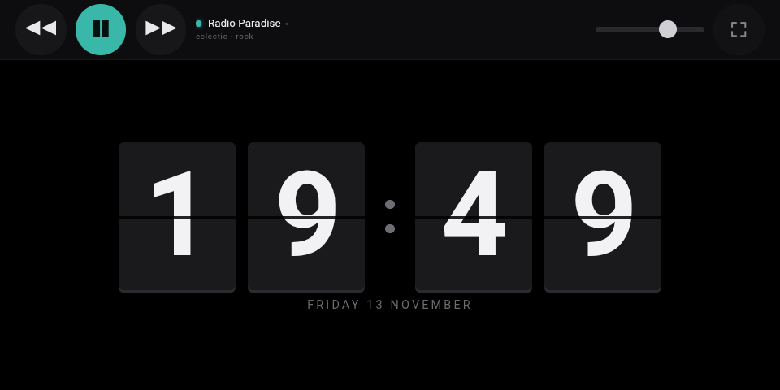
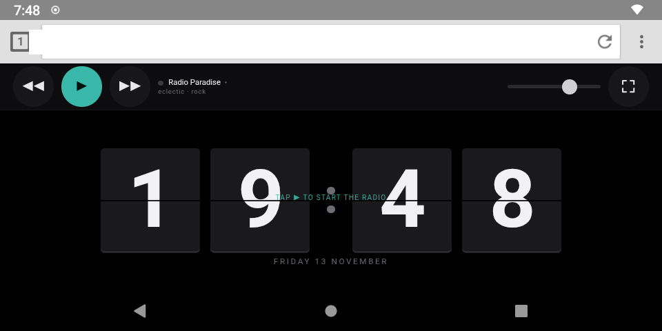
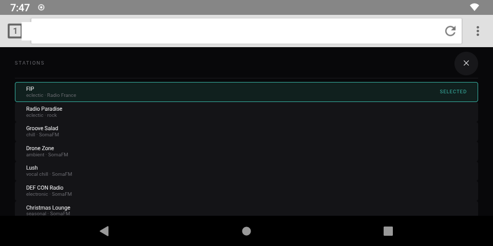
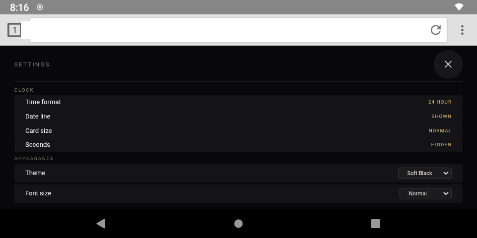
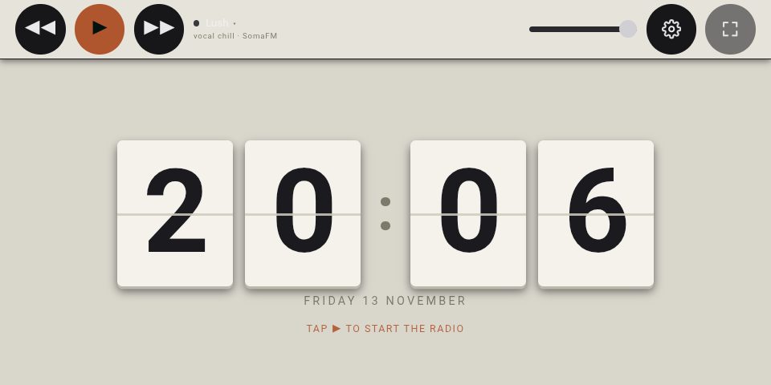
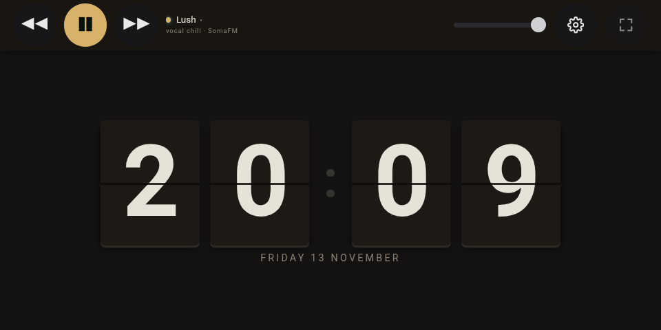
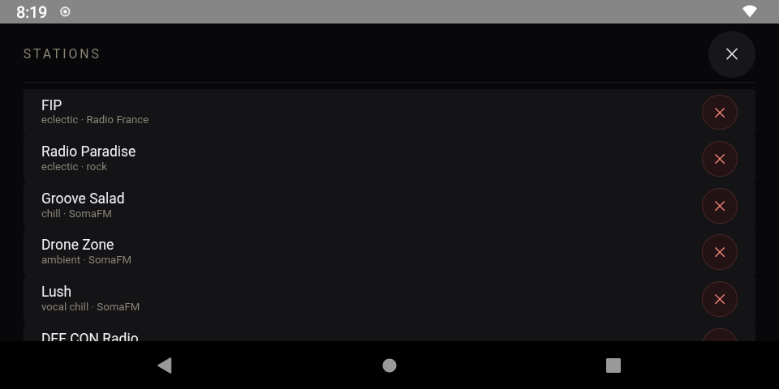
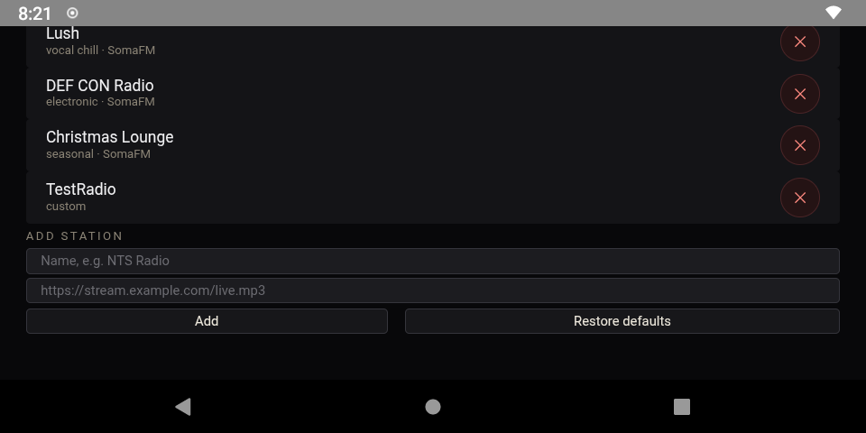
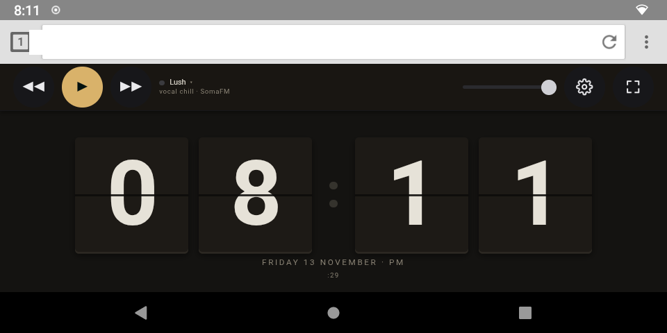
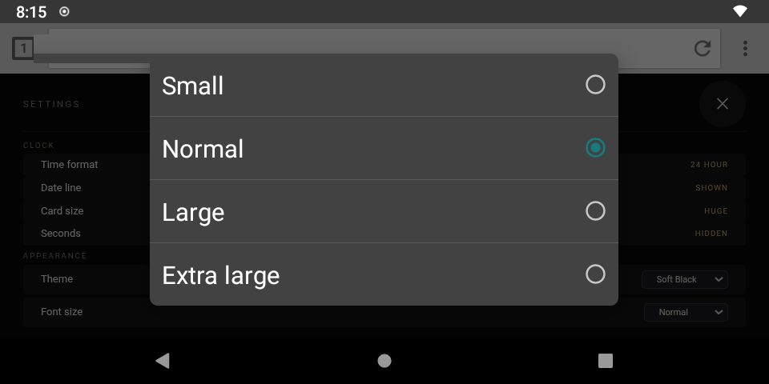

# Flip Clock Radio

A single-file flip clock with an internet-radio player, built for small, old, **1 GB RAM** Android panels used as bedside clocks or Home Assistant kiosk displays.

The shipped page is one self-contained `index.html` with no runtime dependencies, no tracking and no external assets — drop `public/index.html` on any static host. Sources are split for editing and bundled by Vite.



## Why this exists

Kiosk dashboards are heavy, and the devices people actually have lying around — an Echo Show 5 on LineageOS, an old tablet, a wall-mounted phone — have 1 GB of RAM and a WebView from 2021. This ships as a single page so it costs one WebView process instead of an app plus a browser, and it still gives you a clock you can read across a room and a radio station playing underneath it.

It was written for an **Amazon Echo Show 5 (2nd gen, `C76N8S` / `cronos`)** running **LineageOS 18.1 / Android 11**, hosted from Home Assistant, and displayed in Lightning Browser. It works on any Android browser or desktop browser with JavaScript.

## Features

- **Split-flap flip clock** — cards with a seam down the middle, animated per digit, sized in `vh`/`vw` so it fits any screen
- **Weekday + date** line, blinking colon
- **Internet radio** — preset stations, play/pause, previous/next, volume, remembered across reloads
- **Station picker** — tap the station name for a full list with genre labels
- **Fullscreen button** plus tap-the-clock to toggle
- **Four clock options** — 12/24-hour, date line on/off, three card sizes, seconds on/off
- **Editable station list** — add any stream URL in the app, delete stations (including the built-in ones), restore the defaults
- **Ten colour themes**, plus a **font size** dropdown, both remembered per device. The default theme, **Soft Black**, is warm off-white `#E6E2D8` on warm near-black `#141311` — deliberately not `#fff` on `#000`
- **MediaSession metadata** — station name and genre appear on the lock screen or paired phone
- **Night dimming** 23:00–07:00, so a bedside panel is not a lighthouse
- **Screen Wake Lock**, auto-resume after the tab sleeps, and a live/error dot for stream state
- **Keyboard**: `Space` play/pause, `f` fullscreen, `Esc` close picker

| Windowed | Stations | Settings |
|---|---|---|
|  |  |  |





## Quick start

`public/index.html` is the built, self-contained page — no Node required to use it:

```bash
# 1. just open it
open public/index.html     # macOS   (start public\index.html on Windows)

# 2. any static server
python3 -m http.server 8099 --directory public

# 3. Home Assistant — copy public/index.html into config/www/ then browse to:
#    http://<your-ha>:8123/local/index.html
```

To change it, build it:

```bash
npm install        # Vite + esbuild + vite-plugin-singlefile (dev only)
npm run build      # minified single file -> public/index.html
```

For a wall panel, point a kiosk browser (Fully Kiosk Browser is the usual choice) at the URL and enable its keep-screen-on option.

## Development

The sources are split; the build inlines and minifies them back into one file.

| Path | What |
|---|---|
| `index.html` | Vite entry: `<head>`, the pre-paint theme/font script, CSS link, markup |
| `src/styles.css` | all CSS |
| `src/main.js` | all app logic (one IIFE, no imports) |
| `public/index.html` | generated single-file build — do not edit |
| `vite.config.js` | build config (`chrome90` target, everything inlined) |

```bash
npm run dev        # dev server with reload, http://localhost:5173
npm run build      # minified single file -> public/index.html
npm run preview    # serve the built file
```

`public/index.html` is committed so a checkout stays drop-in usable. The build targets Chromium 90 (Android 11 WebView) and lands at roughly 28 KB minified (~9 KB gzipped).

GitHub Pages is deployed from `public/` by `.github/workflows/pages.yml` on every push to `main`. The repository-root `index.html` is the Vite source template, not the deployed page; the repo's Pages source must be set to **GitHub Actions** once in Settings → Pages.

## Configuration

Everything you'd normally change lives at the top of `src/main.js`, inside the IIFE:

```js
var STATIONS = [
  { name: "FIP", sub: "eclectic · Radio France", url: "https://icecast.radiofrance.fr/fip-midfi.mp3" },
  ...
];
```

Add, remove or reorder entries freely — the picker and the arrows are generated from this array. Run `npm run build` to refresh `public/index.html`.

Notes on stream URLs:

- **Use `https://` if the page is served over HTTPS**, or the browser blocks mixed content.
- MP3 and AAC (`.mp3`, Icecast/Shoutcast) both work in the WebView player. HLS (`.m3u8`) does **not** without extra code.
- Stations that require a session cookie or a Referer header often fail in a plain `<audio>` element.

The night-dimming window is the `h >= 23 || h < 7` test in `tick()` in `src/main.js`.

## Stations

Settings → **Stations** opens the manager. Every station can be removed — the built-in list is only a starting point, not a fixed set.

| Action | How |
|---|---|
| Remove a station | the red ✕ on its row |
| Add a station | type a name and a stream URL, then **Add** |
| Get the defaults back | **Restore defaults** at the bottom |



Details that matter:

- **Nothing is baked in.** The live list is `DEFAULT_STATIONS` copied at first run, then kept in `localStorage` under `fc.stations`. Edit the array in `src/main.js` (then rebuild) to change the shipped defaults; edit them in the app to change your device.
- **New built-in stations reach existing devices.** Entries tagged with `since` are merged into an already-saved list once, keyed by `fc.stationsV`; user-added stations are kept and deletions are not resurrected. When shipping more presets, bump `STATIONS_VERSION` and tag the new entries.
- **URL validation is minimal on purpose** — anything starting with `http://` or `https://` is accepted, because stream endpoints vary wildly. A wrong URL shows as a red dot and "stream unreachable" rather than being rejected up front.
- **Deleting the station that is playing** stops playback and falls back to the next one, and the arrows wrap around the shortened list.
- **Delete everything** and the clock keeps working; the player shows "No stations" until you add one or restore defaults.



The panel header is sticky, so the close button stays reachable while you scroll a long list.

## Clock options

Settings → **Clock** holds four options. Each row cycles through its values when tapped, and everything is stored in `localStorage` under `fc.clock`:

| Option | Values | Notes |
|---|---|---|
| **Time format** | `24-hour` / `12-hour` | 12-hour appends `· AM` / `· PM` to the date line |
| **Date line** | `shown` / `hidden` | hiding it gives the cards more vertical room |
| **Card size** | `normal` / `large` / `huge` | 38 / 42 / 44 vh tall; **`huge` is the default**; it's the practical ceiling before the date line meets the control bar |
| **Seconds** | `hidden` / `shown` | small readout under the date, updated every second |



Adding a fifth option means one entry in `CLOCK_DEFS` (`src/main.js`) plus a CSS rule in `src/styles.css` keyed off a body class — `applyClock()` toggles the classes and forces a redraw.

### Appearance

Below the clock options, two native dropdowns sit in an **Appearance** section:

| Dropdown | Values | Stored as |
|---|---|---|
| **Theme** | the ten palettes below | `fc.theme` |
| **Font size** | 12 px · 14 px · … · 24 px (default 12 px) | `fc.fs` |

Font size sets a single `--fs` value in pixels — **12 px by default, then 14, 16 … 24 px in 2 px steps** — that sizes the interface text: station name, panel headings, rows and labels. The control bar grows with it so it never covers the clock. It deliberately does **not** scale the clock digits: that's what the Card size option is for, and scaling both would make the two controls fight each other.



One implementation note: on Android the native select closes with a tap that also lands on the page, which was shutting the settings panel the moment you chose something. A 700 ms backdrop guard after each `change` fixes it.

## Themes

The gear button opens Settings. Appearance holds a **Theme dropdown** with the ten palettes below. The choice is stored in `localStorage` (`fc.theme`) and re-applied by a tiny inline script in `<head>` **before first paint**, so a light theme never flashes dark on reload. The same script applies the saved font size (`fc.fs`), so text never jumps a size on reload either.

**The default is Soft Black, and that's a readability decision, not a style one.** Pure white on pure black is the highest-contrast pairing available and also the most fatiguing: the extremes make edges appear to bloom, which is worst for astigmatic eyes and after dark. So the default pairs a warm off-white `#E6E2D8` (an ivory-leaning grey, not `#FFFFFF`) with a warm near-black `#141311` rather than `#000000`. Contrast stays high, the blue-light cast drops, and long reading is easier. The warm family is completed by **Ivory** (`#FAF8F5` on `#100F0D`) and **Oatmeal** (`#EAE0C8` on `#17130D`, a seppia-like tone).

| Theme | Background | Digits |
|---|---|---|
| **Soft Black** (default) | `#141311` | `#E6E2D8` |
| Ivory | `#100F0D` | `#FAF8F5` |
| Oatmeal | `#17130D` | `#EAE0C8` |
| Midnight | `#000000` | `#F2F2F4` |
| Paper | `#D9D6CC` (light) | `#1B1B1F` |
| Amber CRT | `#0A0700` | `#FFB347` |
| Ocean | `#00060D` | `#D8ECFF` |
| Forest | `#030804` | `#DCF5E0` |
| Rose | `#0D0308` | `#FFE0EC` |
| Mono | `#000000` | `#FFFFFF` |

Each theme is just a block of custom properties in `src/styles.css`, so adding your own is one rule:

```css
html[data-theme="neon"] {
  --bg:#04010a; --card:#100524; --card-edge:#2a0f52; --digit:#f0e6ff;
  --dim:#7a5ba8; --seam:#05010c; --accent:#b96bff; --bar:#0a0316; --ink:#f0e6ff;
}
```

…then add `{ id:"neon", name:"Neon", sw:["#100524","#f0e6ff","#b96bff"] }` to the `THEMES` array in `src/main.js` and rebuild — the swatches in Settings are generated from those three colours.

`--ink` is the text colour used on the control bar; light themes need a dark one. Night dimming (23:00–07:00) fades only the clock, so it stays readable across every theme.

## Controls

| Action | Result |
|---|---|
| Tap the clock (not playing) | starts the radio |
| Tap the clock (playing) | toggles fullscreen |
| ‹‹ / ›› | previous / next station |
| Tap the station name | opens the station picker |
| Gear button | opens settings / themes |
| ⛶ top right | fullscreen |
| Volume slider | sets stream volume, remembered |
| `c` / `Esc` | open settings / close any panel |

## Tested on

| | |
|---|---|
| Device | Echo Show 5 (2nd gen), 960×480, 1 GB RAM |
| OS | LineageOS 18.1 (Android 11) |
| Browser | Lightning (Chromium WebView) |
| Host | Home Assistant `config/www/`, and a local `python -m http.server` while developing |

## Gotchas worth knowing

These cost real time on the device, so they're documented rather than discovered:

1. **JavaScript must be enabled.** Browsers that disable JS by default — Privacy Browser ships that way — render the page as frozen static HTML: no clock updates, no audio, and the initial "tap to play" text never disappears. That looks like a bug in the page, but it isn't.
2. **Browsers block autoplay.** Audio needs one user gesture, which is why the page starts on a tap rather than on load.
3. **Android's navigation bar overlays the WebView.** The page reserves bottom padding when windowed and removes it in fullscreen; without it the control bar hides under the nav bar.
4. **`fullscreen` is lost on reload**, so a kiosk host should provide immersive mode instead of relying on the page.
5. **Some browsers set `FLAG_SECURE`**, which makes `adb shell screencap` produce an empty file. Useful to remember when screenshotting the device — Lightning captures fine, Privacy Browser does not.

## Credits and third-party notices

**The code is original.** Everything in this repository — the flip animation, layout, player, station picker, night dimming — was written for this project. The built page bundles no third-party libraries, no web fonts, no icon sets and no images: it uses system font families and standard browser APIs (`<audio>`, MediaSession, Wake Lock, Fullscreen), which is also why it stays small enough for a 1 GB device. Vite and esbuild are build-time tools only and are not shipped.

**The stations are not ours.** The stream URLs point at services run by [SomaFM](https://somafm.com/), [Radio France](https://www.radiofrance.fr/) (FIP) and [Radio Paradise](https://radioparadise.com/). This repository stores **only links** — no audio is copied, cached or redistributed — and it is not affiliated with, endorsed by, or sponsored by any of them. Station names are used descriptively to identify the streams. There is deliberately no station artwork or logo in `assets/`.

Two consequences worth knowing:

- These are third-party services. They can change URLs, add restrictions, or stop public streaming at any time, and their terms govern your use of them. Replace the entries in `STATIONS` with sources you are entitled to use.
- If you publish a fork, keep it link-only. Bundling recorded audio, station logos or branded artwork would raise issues this licence does not cover.

**The device platform is separate.** LineageOS, amonet, TWRP and the Echo Show camera/Bluetooth patchsets are independent projects under their own licences (Apache-2.0, GPL-2.0, MIT). They are referenced here as the environment this page was tested on and are **not** distributed in this repository; nothing here depends on their source code.

5. **Some stations reject the `curl` user agent.** SomaFM answers `403 Forbidden` to `curl/7.x` and even to a bare `Mozilla/5.0`, while accepting a full browser UA — which is what a WebView sends, so playback works while a command-line probe looks broken. If you test stream URLs from a shell, pass a realistic UA:
   ```bash
   curl -s -A 'Mozilla/5.0 (Linux; Android 11) AppleWebKit/537.36 Chrome/120 Mobile' <url>
   ```

## License

MIT — see [LICENSE](LICENSE).
